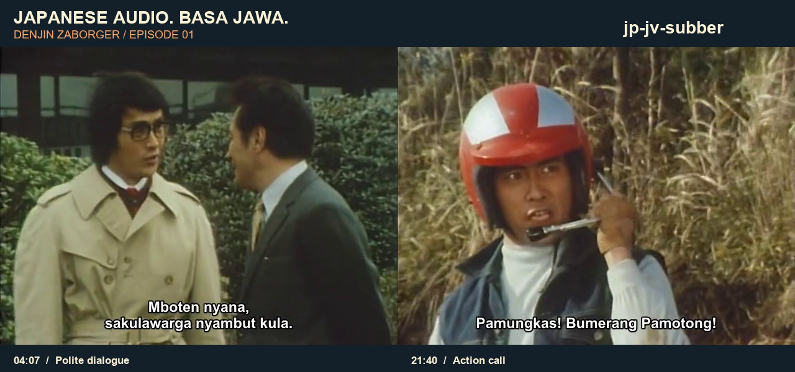

# jp-jv-subber

[](https://github.com/asfarsadewa/jp-jv-subber/actions/workflows/checks.yml)


**Japanese tokusatsu. Basa Jawa. Ready to watch.**

An agent-operated pipeline that takes Japanese audio through transcript review, contextual Javanese translation and subtitle layout, then delivers a compact **480p MP4 with hardsubs**. Editable **SRT, VTT, ASS** and a bilingual review table come with it.

Default language: everyday Javanese ngoko in Latin script, with polite speech where character relationships call for it. The original Japanese audio stays in the video.

## See it: Denjin Zaborger

[](docs/assets/zaborger-javanese.jpg)

Actual frames from our completed episode 01 export, with the subtitles already burned into the picture. Click the image for full size.

| Scene | Javanese subtitle |
| --- | --- |
| Polite dialogue · 04:07 | “Mboten nyana, sakulawarga nyambut kula.” |
| Action call · 21:40 | “Pamungkas! Bumerang Pamotong!” |

This episode produced **177 subtitle cues** and a **640 × 480 MP4 of about 89 MB**, retaining the Japanese audio. Translation received model-assisted source and translation review; native-speaker approval is still separate. The public repository contains this two-frame preview; the full episode, transcripts and subtitle files stay local.

## Already have subtitles? Burn them in

After installing the [dependencies below](#setup), use an existing **ASS, SRT or VTT** file:

```sh
python tools/subtitle.py burn --source "input/episode.mkv" --subtitles "subbed/episode-01.jv.ass"
```

That saves **`subbed/episode-01.jv.480p.mp4`**. No API keys, transcript or project initialization are needed. ASS styling and placement are retained; SRT/VTT use readable white text with a dark outline.

Choose another destination or explicitly replace a previous export:

```sh
python tools/subtitle.py burn --source "input/episode.mkv" --subtitles "captions.jv.srt" --output "subbed/episode-01.jv.480p.mp4" --overwrite
```

Burn-in uses the supplied wording and timestamps as-is. It preserves display aspect ratio and frame rate, encodes H.264 with Japanese AAC audio, checks fast-start and decodes the complete result before saving the final file. Inputs are protected from replacement. Logs, verification and hashes live in ignored `work/burns/`. Use an optional `--project` to select local encoding/font settings.

## Start with an agent

Open this repository in Codex and ask:

```text
Use $jp-jv-subber to subtitle my Japanese episode in Javanese,
review the uncertain dialogue, and save a verified 480p MP4 in subbed/.
```

The local skill is [`.agents/skills/jp-jv-subber/SKILL.md`](.agents/skills/jp-jv-subber/SKILL.md). [AGENTS.md](AGENTS.md) routes agents to it; no global skill installation is needed. Other agents can read those same files directly.

For subtitles that already exist, ask: “Use `$jp-jv-subber` to burn this ASS file into my video and save a verified 480p MP4 in `subbed/`.”

## Setup

Use Python 3.11+, FFmpeg/ffprobe with libass, libx264, AAC, FLAC and MP3 encoding, and Arial, Liberation Sans or DejaVu Sans fonts.

```sh
python -m pip install -r requirements.lock.txt
python tools/subtitle.py init --slug show-01 --series "My show" --episode 01 --source "input/episode.mkv"
python tools/subtitle.py doctor
python tools/subtitle.py status
```

Supply `OPENAI_API_KEY` and `ELEVENLABS_API_KEY` through the process environment. `.env.example` lists their names; `.env` files are not loaded automatically. `doctor` reports presence only. Add `--check-models` for a read-only OpenAI model access check.

Edit ignored `project.json` to set series context, confirmed names/glossary, music ranges in seconds and language preferences. For several episodes, use separate configs under `local/`, always with a unique slug, and pass `--project` to every command. Place episode-specific overrides beside that config.

## Workflow

```text
Japanese audio
  → Scribe v2: Japanese words, timestamps, anonymous speakers
  → Independent ASR + source review + sampled scene images
  → GPT-6 Luna: contextual Japanese → Javanese draft
  → GPT-6.1 Sol: full translation review
  → Timing, line breaks and reading-speed checks
  → SRT / VTT / ASS / review TSV
  → 480p H.264 + Japanese AAC audio, subtitles burned in
  → Complete decode, export parity, fast-start and visual QA
```

Follow the [production runbook](docs/workflow.md) for commands, corrections and recovery. Resume the needed stage; changing a subtitle does not require paying to transcribe again. `all` supports uninterrupted runs and stops at failed source/QA checks. Agents still inspect source doubts and rendered samples before reporting completion.

Speaker labels are evidence about voices, not reliable character identities. ASR and alignments can be wrong, particularly under fight effects or during songs. Source doubts remain in review notes. Model review does not imply native-speaker approval.

## Verify without API credits

```sh
python tools/verify_project.py
```

This runs unit checks and generates synthetic media to exercise extraction, exports, standalone ASS/SRT/VTT burn-in without a config, 4:3/anamorphic 16:9 geometry, full decoding and visible subtitle pixels. It does not transcribe or translate real audio. GitHub Actions runs the same offline checks and a secret scan.

## Public repository boundary

Code, prompts, the local skill, documentation, configuration templates and tests belong in Git. The explicitly approved [Zaborger README preview](docs/assets/zaborger-javanese.jpg) is the sole media exception, allowed by exact path. Full episodes, transcripts, subtitle files, other frames, API receipts, local settings and credentials stay outside Git. Paid stages send supplied audio and selected transcript/images to the configured providers; CI does not run those stages.

`python tools/public_audit.py` checks the tracked file set against this boundary, including preview format, size and metadata. Follow [release checks](docs/release.md) before an authorized push. Source footage belongs to its respective rights holders; the README frames illustrate the subtitle output.

## API documentation

- [ElevenLabs Scribe](https://elevenlabs.io/docs/api-reference/speech-to-text/convert)
- [GPT-6 Luna](https://developers.openai.com/api/docs/models/gpt-6-luna) and [GPT-6.1 Sol](https://developers.openai.com/api/docs/models/gpt-6.1-sol)
- [Structured outputs](https://developers.openai.com/api/docs/guides/structured-outputs) and [background responses](https://developers.openai.com/api/docs/guides/background)
- [File transcription](https://developers.openai.com/api/docs/guides/speech-to-text) and [forced alignment](https://elevenlabs.io/docs/api-reference/forced-alignment/create)
- [Codex local skill discovery](https://developers.openai.com/codex/skills#where-codex-loads-local-skills)
